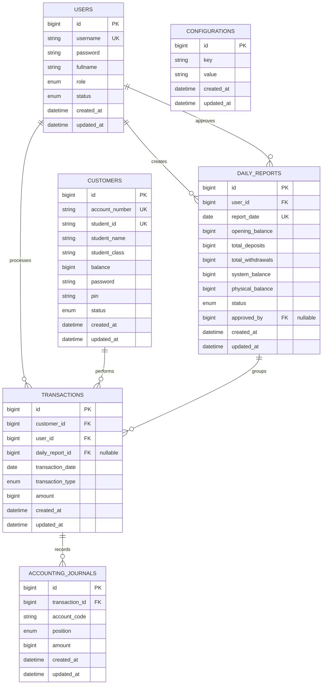

# Project ERD

This ERD covers the core business tables for the savings/transaction system. Laravel framework tables such as `sessions`, `jobs`, and token tables are intentionally omitted for clarity.

## Relationship notes

- A user may create multiple daily reports and perform multiple transactions.
- A customer may have many transactions but each transaction belongs to one customer.
- Each transaction can create multiple accounting journal entries (debit/credit split).
- A daily report may be approved by another user and can include many transactions.
- `configurations` is a generic key/value table used for app settings.
